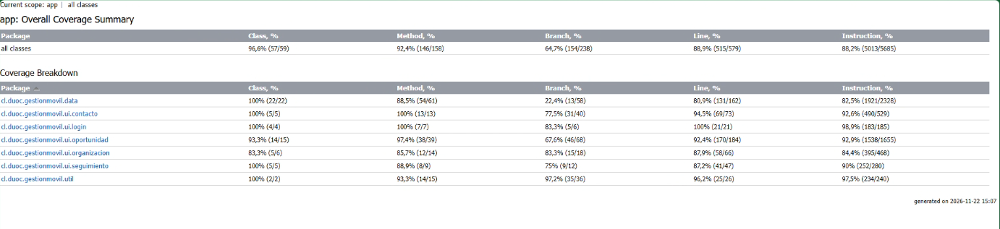

# 📱 Gestión Móvil — Sistema Comercial de Oportunidades y Activaciones

Aplicación móvil nativa desarrollada en **Kotlin** con **Jetpack Compose** y arquitectura **MVVM**, orientada a la gestión comercial de oportunidades de eventos/activaciones, directorio de organizaciones, contactos y bitácora de seguimientos[cite: 39, 41]. El sistema integra persistencia remota mediante **Retrofit** contra un backend propio en **Spring Boot** (`gestionmovil-api`), respaldo local automático con **Room (SQLite)**, consumo de **APIs externas** en tiempo real, pruebas unitarias con cobertura **> 80% (Kover)** y compilación de **APK firmado**.

---

## 👥 Integrantes

* **Jaime Arias** — Desarrollo Android, Arquitectura MVVM, Pruebas Unitarias y Kover
* **Francisca Torres Muñoz** — Integración Retrofit, Backend Spring Boot (`gestionmovil-api`) y APIs Externas

> **Asignatura:** DSY1105 — Desarrollo de Aplicaciones Móviles (Duoc UC)

---

## ⚙️ Funcionalidades Principales

* **Autenticación y Control de Roles (`SUPERVISOR` / `EJECUTIVO`):**
    * Inicio de sesión con precarga automática de usuarios de prueba.
    * **Ejecutivo Comercial:** Visualiza y gestiona únicamente sus oportunidades asignadas, registra nuevos eventos y agrega seguimientos.
    * **Supervisor:** Visualiza todas las oportunidades del equipo, puede reasignar responsables y confirmar o descartar oportunidades de forma definitiva[cite: 41].
* **Dashboard con Información en Tiempo Real (APIs Externas):**
    * Consulta paralela mediante corrutinas del valor del **Dólar observado (CLP)** y las **condiciones climáticas actuales de Santiago** (temperatura, estado y velocidad del viento) para apoyar la planificación de activaciones en terreno, con manejo de estados (`Cargando`, `Éxito`, `Error`) y botón de reintento.
* **Gestión de Oportunidades (CRUD Completo):**
    * Listado reactivo con búsqueda en tiempo real por nombre y filtrado por rol.
    * Formulario con validaciones desacopladas (`util/`) que verifican longitudes mínimas, formatos válidos, costos referenciales no negativos ($\ge 0$), coherencia entre fechas de detección y término, y detección de duplicados[cite: 41].
* **Recursos Nativos del Dispositivo:**
    * **Cámara:** Captura de evidencia fotográfica almacenada en el almacenamiento interno de la app (`context.filesDir`) y vinculada a cada oportunidad[cite: 41].
    * **Calendario:** Agendamiento directo de la activación en la aplicación nativa de Google Calendar mediante `Intent.ACTION_INSERT` (`CalendarContract`)[cite: 41].
* **Directorio y Bitácora de Seguimientos:**
    * Registro de organizaciones (validación de RUT y duplicados), contactos asociados (validación de correo y teléfono) e historial cronológico de gestiones por oportunidad[cite: 41].
* **Persistencia Híbrida (Retrofit + Room Plan B):**
    * Sincronización principal contra microservicios REST en Spring Boot con respaldo automático en Room (SQLite) ante pérdida de conectividad[cite: 39].
* **Calidad y Cobertura de Código:**
    * Suite de pruebas unitarias locales en JVM con **JUnit 4**, **MockK** y `kotlinx-coroutines-test`, alcanzando **99,2% de cobertura de líneas** y **97,5% de instrucciones** verificadas con **Kover**.

---

## 🌐 Endpoints Utilizados

### 1. Microservicio Propio (`gestionmovil-api` — Spring Boot)
**URL Base (Emulador Android):** `http://10.0.2.2:8080/`[cite: 39]

| Módulo | Método | Endpoint | Descripción |
| :--- | :---: | :--- | :--- |
| **Oportunidades** | `GET` | `/api/v1/oportunidad` | Lista todas las oportunidades registradas[cite: 39]. |
| **Oportunidades** | `GET` | `/api/v1/oportunidad/{id}` | Obtiene el detalle de una oportunidad por ID[cite: 39]. |
| **Oportunidades** | `POST` | `/api/v1/oportunidad` | Crea una nueva oportunidad[cite: 39]. |
| **Oportunidades** | `PUT` | `/api/v1/oportunidad/{id}` | Actualiza estado, responsable o datos de una oportunidad[cite: 39]. |
| **Oportunidades** | `DELETE` | `/api/v1/oportunidad/{id}` | Elimina una oportunidad por ID[cite: 39]. |
| **Organizaciones** | `GET` | `/api/v1/organizacion` | Lista todas las organizaciones del directorio[cite: 39]. |
| **Organizaciones** | `POST` | `/api/v1/organizacion` | Registra una nueva organización[cite: 39]. |
| **Organizaciones** | `PUT` / `DELETE` | `/api/v1/organizacion/{id}` | Actualiza o elimina una organización existente[cite: 39]. |
| **Contactos** | `GET` | `/api/v1/contacto` | Obtiene el listado de contactos corporativos[cite: 39]. |
| **Contactos** | `POST` | `/api/v1/contacto` | Crea un contacto vinculado a `organizacionId`[cite: 39]. |
| **Contactos** | `PUT` / `DELETE` | `/api/v1/contacto/{id}` | Actualiza o elimina un contacto por ID[cite: 39]. |
| **Seguimientos** | `GET` | `/api/v1/seguimiento` | Obtiene el historial de seguimientos[cite: 39]. |
| **Seguimientos** | `POST` | `/api/v1/seguimiento` | Registra una gestión vinculada a `oportunidadId`[cite: 39]. |
| **Seguimientos** | `PUT` / `DELETE` | `/api/v1/seguimiento/{id}` | Modifica o elimina un seguimiento[cite: 39]. |
| **Usuarios** | `GET` | `/api/v1/usuario` | Lista los usuarios registrados para autenticación[cite: 39]. |
| **Usuarios** | `POST` | `/api/v1/usuario` | Crea un nuevo usuario (`SUPERVISOR` o `EJECUTIVO`)[cite: 39]. |

### 2. APIs Externas Públicas (Consumo en Dashboard)

| Servicio | URL Base | Método y Endpoint | Datos Consumidos |
| :--- | :--- | :--- | :--- |
| **Mindicador.cl** | `https://mindicador.cl/` | `GET /api` | Valor actual del **Dólar observado (`dolar.valor`)** en pesos chilenos (CLP). |
| **Open-Meteo** | `https://api.open-meteo.com/` | `GET /v1/forecast?latitude=-33.4489&longitude=-70.6693&current_weather=true` | Temperatura actual (°C), velocidad del viento (km/h) y código meteorológico de Santiago. |

---

##  Tecnologías y Arquitectura

* **Frontend Móvil:** Kotlin, Jetpack Compose (Material 3), Navigation Compose, ViewModel + StateFlow (MVVM), Coroutines, Retrofit 2 + Gson, Room Database, FileProvider.
* **Backend:** Java, Spring Boot, Spring Data JPA / Hibernate, Springdoc OpenAPI (Swagger).
* **Base de Datos:** MySQL (`gestionmovil_db`) administrada mediante XAMPP / phpMyAdmin.
* **Pruebas y Calidad:** JUnit, MockK / Coroutines Test, Kover (cobertura de código ≥ 80%).

## 🚀 Pasos para Ejecutar el Proyecto

## 5. Instrucciones de Ejecución

### Paso 1: Base de Datos (XAMPP)
1. Abrir **XAMPP Control Panel** e iniciar **Apache** y **MySQL** (mantener Tomcat detenido para dejar libre el puerto `8080`).
2. Ingresar a `http://localhost/phpmyadmin`, crear la base de datos `gestionmovil_db` e importar el script SQL inicial.

### Paso 2: Backend (Spring Boot en IntelliJ IDEA)
1. Abrir el proyecto `gestionmovil-api` en IntelliJ IDEA.
2. Verificar en `src/main/resources/application.properties` la conexión a `jdbc:mysql://localhost:3306/gestionmovil_db` y `spring.jackson.deserialization.fail-on-null-for-primitives=false`.
3. Ejecutar `GestionmovilApiApplication` y comprobar que responda en `http://localhost:8080/api/v1/organizacion`.

### Paso 3: Aplicación Móvil (Android Studio)
1. Abrir `GestionMovil-main` en Android Studio y sincronizar Gradle.
2. Iniciar un emulador Android (API 34+ recomendada) y presionar **Run**.

### Paso 4: Pruebas Unitarias y Cobertura (Kover)
Ejecutar desde la terminal de Android Studio:
```bash
.\gradlew testDebugUnitTest koverHtmlReport
```
El reporte HTML se genera en `app/build/reports/kover/htmlDebug/index.html`.

---

## 6. Evidencias de Evaluación

### 6.1. Pruebas Unitarias y Cobertura (Kover ≥ 80%)
> 

### 6.2. APK Firmado y Archivo Keystore (`.jks`)
* **Ubicación del APK firmado:** `app/release/app-release.apk`
* **Archivo de firma configurado:** `signingConfigs` en `app/build.gradle.kts` con llave `.jks`.

> 

